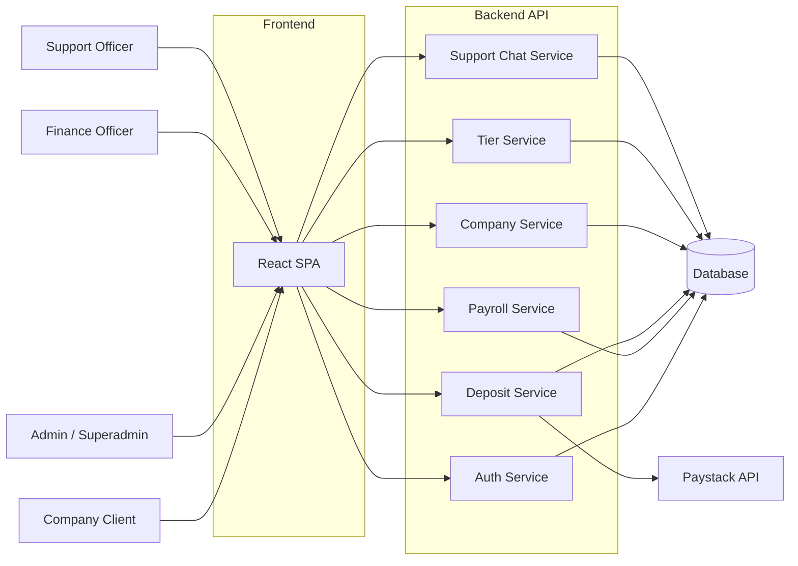
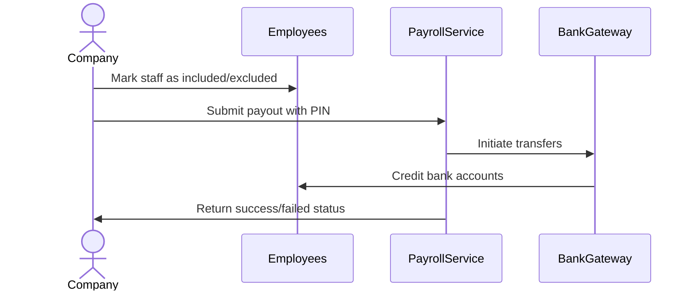
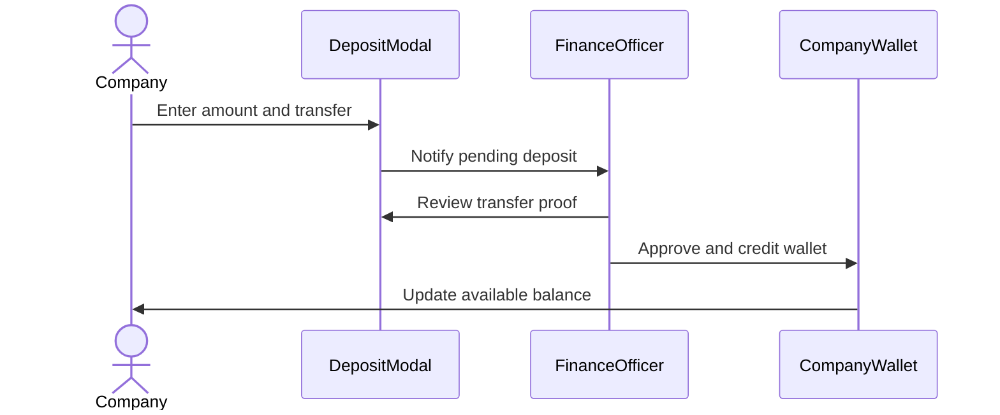
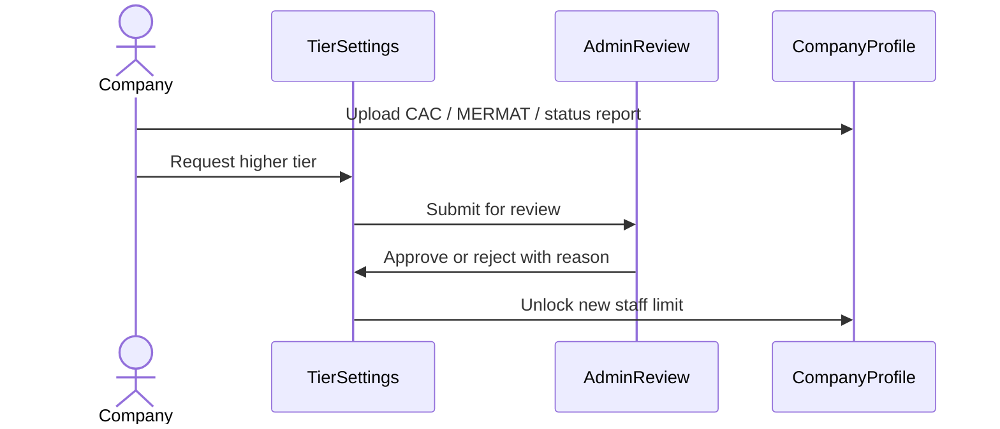

# Payfleet Dashboard

A clean, role-based web dashboard that helps Nigerian companies manage employees, run payroll, fund wallets, and stay compliant, all in one place. It gives finance teams, support staff, and administrators shared visibility into salaries, deposits, verifications, and support conversations without chasing spreadsheets or email threads.

## System Architecture

Payfleet is a single-page React application that talks to a REST backend and renders different interfaces depending on the signed-in user's role.



## Features

**Multi-role dashboards** — Separate workspaces for companies, superadmins, finance officers, and support staff. Each role sees only the actions and data it needs.

**Employee and payroll management** — Add and edit employee records, mark employees in or out of the payroll run, record salary deductions, and process bulk salary payouts protected by a 4-digit transaction PIN.

**Wallet deposits and reconciliation** — Companies can generate deposit requests, transfer to a dedicated settlement account, and track pending and completed funding. Finance officers review and approve incoming deposits before wallets are credited.

**Company verification and tier upgrades** — Upload CAC, MERMAT, and status report documents. Admins review KYC submissions and approve tier upgrades that unlock higher staff limits.

**Live support chat** — Built-in messenger between companies and the support team, with preset FAQ responses, unread badges, and conversation tracking.

**Notifications and audit logs** — Real-time activity feed for each company plus unread notification badges.

### Payroll Processing Flow



### Deposit Approval Flow



### KYC Tier Upgrade Flow



## Usage

After starting the development server, the application is available at the local Vite host. The default entry route is the login page.

### Running locally

```bash
npm run dev
```

### Building for production

```bash
npm run build
```

Preview the production build:

```bash
npm run preview
```

Run the type checker and linter:

```bash
npm run type-check
npm run lint
```

### Signing in

The login flow supports company accounts and internal staff accounts. Based on the role returned from the backend, the user is redirected to the matching dashboard:

- Company users land on `/dashboard/overview`
- Superadmins land on `/admin/dashboard/overview`
- Finance officers land on `/financial/dashboard/overview`
- Support officers land on `/support/dashboard/overview`

### Processing payroll

1. Navigate to the Employees page.
2. Add employees through the employee form or toggle their payroll inclusion.
3. Go to Process Payments.
4. Enter the 4-digit transaction PIN.
5. Confirm to disburse salaries to every included employee.

### Approving a deposit

1. Finance or admin users open the deposit queue.
2. Select a pending deposit record.
3. Confirm the bank transfer.
4. Click Confirm & Credit Wallet to complete the funding.

### Requesting a tier upgrade

1. A company uploads required documents in Settings.
2. Go to Tier & Plan.
3. Choose a higher tier.
4. Submit the request.
5. An admin reviews the documents and approves or rejects the upgrade.

## Technologies Used

| Technology | Description |
|---|---|
| [React](https://react.dev/) | UI library for building the dashboard interfaces |
| [TypeScript](https://www.typescriptlang.org/) | Typed JavaScript for safer component and service code |
| [Vite](https://vitejs.dev/) | Build tool and development server |
| [Tailwind CSS](https://tailwindcss.com/) | Utility-first styling |
| [TanStack Query](https://tanstack.com/query/latest) | Server state, caching, and background refetching |
| [React Router](https://reactrouter.com/) | Client-side routing |
| [Formik](https://formik.org/) | Form state management |
| [Yup](https://github.com/jquense/yup) | Form validation schemas |
| [Axios](https://axios-http.com/) | HTTP client for API calls |
| [Framer Motion](https://www.framer.com/motion/) | Page transitions and micro-interactions |
| [Sonner](https://sonner.emilkowal.ski/) | Toast notifications |
| [jose](https://github.com/panva/jose) | JWT encryption for secure payment tokens |

## Author

Adeleke Oluwamayokun.

- LinkedIn: https://linkedin.com/in/adeleke-oluwamayokun-780a912a5
- X: https://x.com/Mayorkun_27

## Badges

[](https://www.typescriptlang.org/)
[](https://react.dev/)
[](https://vitejs.dev/)
[](https://tailwindcss.com/)
[](https://tanstack.com/query/latest)

[](https://dokugen.samueltuoyo.com)
